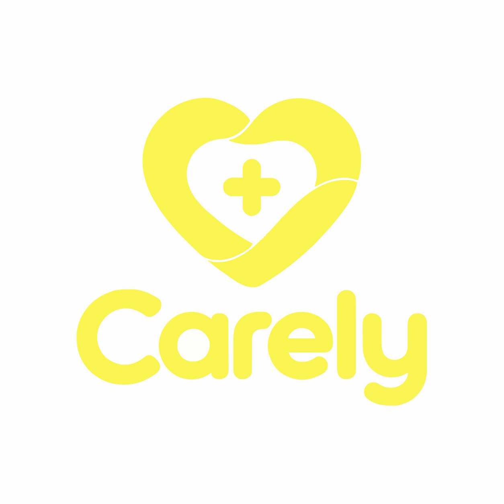

<p align="center">
  
</p>

<h1 align="center">Carely</h1>

<p align="center"><strong>Your whole medical history, in one simple app.</strong></p>

---

Lab results in your inbox. A referral letter somewhere on your desk. Blood pressure readings in a notebook. A visit date on a sticky note. Medication names you can never quite remember when the doctor asks.

**Carely puts all of it in one place.** It is a complete record of your medical history that you carry in your pocket. No more digging through emails, folders and paper piles. Open the app, and it's there.

## What you can keep in Carely

- **📄 Exam history:** every exam with its date, doctor and notes, and the PDF results attached. Open a report in one tap, or send it straight to a doctor from your phone.
- **📅 Planned visits:** upcoming exams and appointments, with what to bring and where to go. Your next visit is always shown at the top.
- **💓 Measurements:** blood pressure, weight & body fat, blood sugar, temperature and oxygen. Each reading tells you whether it's in the normal range, and charts show how it changes over time.
- **💊 Medications:** what you take, how much, how often and why, plus what you took in the past and for how long.
- **📝 Notes:** a simple health diary. Write down how you feel today, so you remember it at your next visit.
- **👤 Profile:** blood type, insurance number and the basics, ready when someone asks.

The **Overview** brings it together: your latest readings, your BMI and where you stand against standard health ranges.

## Why Carely

- **One place for everything.** Your full medical history in one app, not spread across email, paper and memory.
- **Ready at the doctor's.** Show your readings, medications and past results right there, or share the PDFs in seconds.
- **Simple.** Built for the phone first, with clear screens and no clutter.
- **Private.** No account and no sign-up. Your records stay on your device.

> Carely helps you keep and understand your records. It is not a medical device and does not replace advice from your doctor.

## Run it locally

You need [Node.js](https://nodejs.org/) 20 or newer.

```bash
npm install
npm run dev
```

The first time you open the app, it shows sample data so you can see how everything looks.

| Command         | Description                       |
| --------------- | --------------------------------- |
| `npm run dev`   | Start the app for development     |
| `npm run build` | Build for production into `dist/` |
| `npm test`      | Run the tests                     |
| `npm run lint`  | Check the code with ESLint        |

## Built with

React, Vite, Tailwind CSS, TanStack Query, Recharts and Framer Motion. Tested with Vitest and React Testing Library.
